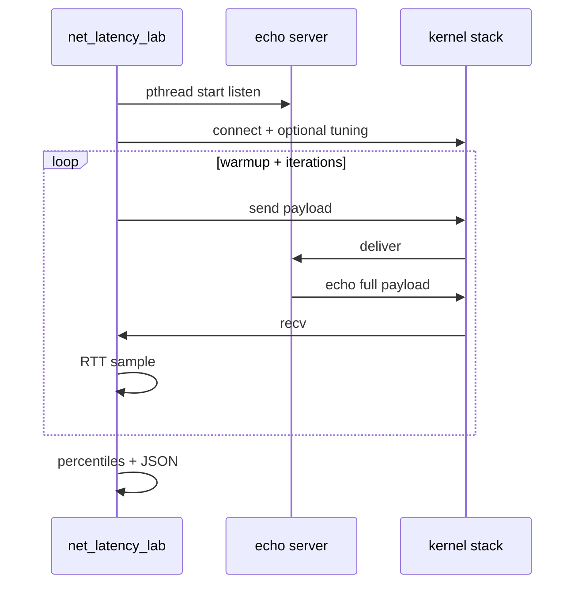

# Transport Latency Laboratory

C11 microbenchmark for **TCP**, **UDP**, and optional **SCTP** round-trip time on Linux. The binary drives loopback or two-host echo tests, records **p50 / p95 / p99 / p99.9**, exports JSON, and ships Python helpers for sweeps, diffs, and HTML tables.

Use it when you want stack latency in nanoseconds with the same discipline as a larger benchmarking effort: fixed CLI, manifest capture, schema validation, and CI that fails on regressions.

## What it measures

| Layer | What you learn |
|-------|----------------|
| TCP stream | Connect + send/recv path, Nagle on/off, parallel clients |
| UDP datagram | Single-shot RTT without connection setup on later packets |
| SCTP stream | Same echo pattern when `libsctp` is available |

This is **not** a throughput tool like iperf. It is an RTT focused lab with percentile tails and optional histogram buckets.

## Architecture

```
                 ┌──────────────────────────────────┐
                 │        net_latency_lab            │
                 │  selftest | manifest | serve | bench │
                 └───────────────┬────────────────────┘
                                 │
           ┌─────────────────────┼─────────────────────┐
           ▼                     ▼                     ▼
    ┌─────────────┐       ┌─────────────┐      ┌─────────────┐
    │ echo server │       │ JSON v2     │      │ manifest v2 │
    │ thread pool │       │ stats+histo │      │ cpu+sysctl  │
    └──────┬──────┘       └──────┬──────┘      └─────────────┘
           │                     │
           ▼                     ▼
    Linux network stack    validate_json.py
                                 │
                    ┌────────────┼────────────┐
                    ▼            ▼            ▼
              run_sweep.py  compare_runs.py  report_html.py
```

### Single-host bench flow



### Two-host mode

Terminal A:

```bash
./build/net_latency_lab serve tcp --bind 0.0.0.0 --port 9200 --payload 512
```

Terminal B:

```bash
./build/net_latency_lab manifest --output host-b.json
./build/net_latency_lab bench tcp --connect 10.0.0.2 --port 9200 --output rtt.json
```

Capture manifest on both machines before you trust a cross-host number.

## Build

```bash
sudo apt-get install -y cmake ninja-build libsctp-dev
mkdir -p build && cd build
cmake .. -GNinja
ninja
```

## Quick verification

```bash
./scripts/ci_local.sh
```

Runs CTest, smoke benches, default sweep manifest, JSON validation, a TCP Nagle compare, and `results/report.html`.

## CLI reference

| Command | Purpose |
|---------|---------|
| `selftest` | TCP + UDP + SCTP loopback smoke |
| `manifest --output path` | Host, CPU model, governor, net sysctl snapshot |
| `serve tcp\|udp\|sctp` | Long-lived echo server for remote clients |
| `bench ...` | RTT capture to JSON |

Bench knobs:

| Flag | Meaning |
|------|---------|
| `--warmup` / `--iterations` | Samples after warmup count toward percentiles |
| `--payload` | Echo size (minimum 16 bytes) |
| `--tcp-nodelay 0\|1` | Force Nagle setting on TCP clients |
| `--sndbuf` / `--rcvbuf` | Socket buffer bytes when nonzero |
| `--clients N` | Parallel TCP clients (server accepts concurrently) |
| `--pin-cpu N` | Pin client worker threads to CPU N |

Example:

```bash
./build/net_latency_lab bench tcp --output results/tcp.json \
  --iterations 500 --payload 1024 --tcp-nodelay 1 --clients 4
```

## Sweep manifests

`manifests/default_sweep.json` lists several cases. Run them with:

```bash
python3 python/run_sweep.py manifests/default_sweep.json build/net_latency_lab
```

Outputs land in `results/sweep/` plus an `index.json`.

Compare two captures:

```bash
python3 python/compare_runs.py results/sweep/00_tcp_p64.json results/sweep/01_tcp_p64.json
```

HTML summary:

```bash
python3 python/report_html.py results/report.html results/sweep/*.json
```

## JSON schema

Bench files use `net_latency_lab/2` with `stats.histogram_ns` (12 buckets) and `p999_ns`. See `docs/SCHEMA.md`. Manifest files use `net_latency_lab_manifest/2`.

## Repository layout

| Path | Role |
|------|------|
| `src/` | Echo servers, benches, timing, stats |
| `python/` | Validation, sweep driver, compare, HTML report |
| `manifests/` | Sweep case lists |
| `docs/TUNING.md` | Host and socket tuning notes |
| `scripts/ci_local.sh` | Full local CI entry point |
| `.github/workflows/ci.yml` | Ubuntu CI |

## Relation to cellular transport (informal)

UDP echo RTT is a stand-in for small user-plane packets. SCTP coverage mirrors control-plane style associations on Linux lab hosts. Numbers here do not replace end-to-end core or RAN KPIs; they isolate the **local or LAN stack** so you can test methodology before bigger setups.

## Author

Jay Sawant
